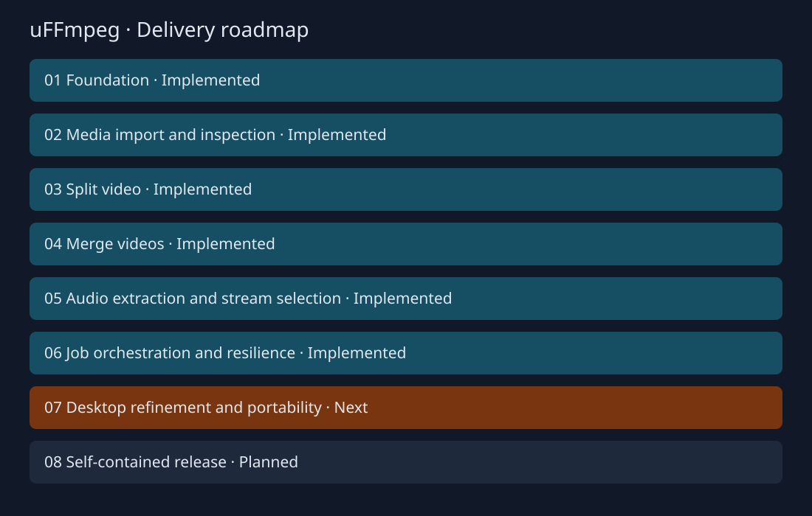

# uFFmpeg

Native Rust + Slint video editor, Apple Silicon first. Internal crate names currently use frameforge. Phases 1–7 contain the desktop shell, modular workspace, native multi-file import, ordered media library, stream details, temporary thumbnails, background engine discovery and typed FFprobe inspection. Multi-range split, ordered merge, audio extraction and per-source stream selection are implemented. FIFO jobs, progress, cancellation and local job history are implemented. Desktop menus, saved defaults, remembered folders and output reveal are implemented. Phase 8 packaging and GitHub release workflows are implemented; the first hosted build and release acceptance remain pending.

## Run locally

```sh
cargo run -p frameforge-desktop
cargo run -p frameforge-desktop -- --diagnostics
cargo run -p frameforge-desktop -- --probe /absolute/path/to/video.mp4
cargo run -p frameforge-desktop -- --inspect /absolute/path/to/video.mp4
```

Rust 1.92+ and native platform build tools are required. Debug builds discover an FFmpeg/FFprobe pair through FRAMEFORGE_FFMPEG_DIR, installed resources, then PATH. Release builds require bundled resources. Cargo downloads dependencies on first build. No React, JavaScript, webviews, Java or test cases.

## Project map

- apps/desktop: compiled Slint UI and event-loop adapter.
- crates/domain: media metadata models.
- crates/engine: discovery, version inspection and FFprobe processes.
- crates/application: UI-independent application diagnostics.
- sprint/: eight individual phase plans.
- assets/: original SVG architecture and roadmap diagrams.
- packaging/: release resource contract and unsigned macOS staging script.

See [architecture](docs/architecture.md), [packaging and licenses](docs/packaging.md), [phase plans](sprint/README.md), and [progress](docs/progress.md).



## GitHub releases

Follow [GitHub setup and release instructions](docs/github-release.md). Push a matching version tag to build macOS Apple Silicon, Windows x64 and Linux x64 installers, bundled media tools, source archives and checksums. CI attaches them to a draft Release; you review and publish it. Initial packages are unsigned/ad-hoc signed.

## Build installers

See [release commands](packaging/release/README.md) for pinned bundled media tools, macOS DMG, Windows installer and Linux Debian packaging. The agent has not run Phase 8 artifact generation.

## Desktop refinement

Use File/View menus or Command/Control+O, 1–4 and comma to navigate. Settings saves current export defaults; folder choices are remembered automatically. Jobs → Show output in folder locates published files. Build a local macOS app with `packaging/stage-dev-macos.sh`. See the [desktop guide](docs/desktop.md) for details and limitations.

## Media library

Choose **Add media…** to select video or audio files. Inspection runs in the background; successful items are added in picker order, while failures appear in the status area. Select a clip to view its preview and streams. **Move up**, **Move down** and **Remove** update the in-memory list. Source files are never modified. The library is session-only; saving projects is future work.

Linux file dialogs use the XDG desktop portal backend; a working portal service and backend are required. Windows uses native dialogs and macOS uses its native file panel. See [desktop portability evidence](docs/progress.md) for native builds, cross-target checks and outstanding platform interaction checks.

## Split video

Select a video, enter **Start** and **End** in decimal seconds, and choose **Add range**. Repeat for additional clips; ranges belong to their source and stay in insertion order. Remove an unwanted range with **Remove range**. Choose the export mode, then **Export segments…** and select an existing destination folder.

- **Accurate re-encode** (default): MP4 with native MPEG-4 Part 2 video and AAC audio. Cuts follow source frame/sample boundaries; this is lossy and is not an H.264 preset.
- **Fast copy** (uncheck accurate): MKV using source codecs. Cuts can include earlier keyframes, so clip start and duration may differ from the entered range. Unsupported codec/container combinations fail with guidance to use accurate mode.

By default, both split modes export the first moving video stream and all audio tracks. The Phase 5 stream controls let you choose a different moving video and check only the audio tracks you want; uncheck all audio for a silent video split. Subtitles, artwork, additional video streams and chapters are excluded. Sources without audio are supported for video splits. A known positive duration is required for ranges. Enter `0 ≤ start < end ≤ source duration`; each range is a separate file, and overlapping ranges are allowed.

Files use `SOURCE-segment-001.mp4` or `.mkv`. Existing files are never replaced. All names are checked before export; clips are written to temporary files in the destination, probed and then published without overwrite. If a later clip fails, earlier completed clips remain, and the status lists their paths. Temporary files from ordinary failures are removed. Use Jobs → Cancel to stop an operation safely. Normal closing cancels unfinished work and waits for cleanup; forced-exit limits are described below. Each segment currently has a one-hour processing deadline.

Export snapshots are queued; the UI lets you prepare additional imports/exports while the worker runs. Normal closing requests cancellation and waits for the worker to finish cleanup. The range list is session-only. Phase 7 adds native-menu shortcuts and initial macOS UI inspection; full export interaction and platform accessibility review remain acceptance work.

Equivalent command-line export:

```sh
cargo run -p frameforge-desktop -- --split /absolute/source.mp4 /absolute/output-folder accurate 0.4 1.6 3.2 4.4
```

See [Phase 3 details](sprint/03-split-video.md).

## Merge videos

Add at least two videos, use **Move up / Move down** to set their library order, then choose **Merge videos**. The merge uses every whole clip from top to bottom; split ranges are ignored. Remove audio-only library items before merging. The details panel explains any incompatibilities.

| Mode | Output | Behavior |
| --- | --- | --- |
| Fast copy (default) | MKV | Keeps codecs and every audio track; requires matching stream order/count, codec configuration, timebase, dimensions, pixel format, frame rate and audio layout. |
| Normalize and re-encode | MP4 | Explicit opt-in. Fits the first clip's display canvas with letterboxing at 30 fps, and encodes MPEG-4 Part 2 video plus 48 kHz stereo AAC tracks. |

Fast copy accepts one moving video stream plus audio streams only. Unknown essential metadata, rotation metadata, extra video, artwork, subtitles or data tracks require normalization. Matching metadata cannot guarantee seamless timestamps: source codec delay, AAC priming and unequal stream durations can leave small gaps/overlaps at joins. Choose normalization to rebuild the timeline. A codec that cannot be muxed into MKV fails without publishing an output.

Normalization uses the first moving video from each clip and retains the maximum audio-track count found across inputs, matching tracks by position rather than language or title. Missing tracks become silence; shorter audio is padded, longer audio is trimmed to each clip's known container duration, and shorter video holds its final frame. All-silent input remains video-only. Video is fitted to a square-pixel canvas derived from the first clip's display dimensions (rounded to even values), with a maximum of 16384 pixels per side. Duration is rounded up to a 30 fps boundary per clip. Aspect, sample-rate, channel and pixel-format conversion can change quality; this is not an H.264 or HDR tone-mapping preset. Subtitles, extra video streams and chapters are excluded.

Choose **Save merged video…** and a new filename. Existing paths are refused even if a native save dialog offers overwrite. Export re-probes sources, stages the output beside the chosen destination, verifies streams and duration, then publishes without overwrite. Failed operations clean up staging and normalization files during ordinary execution. Normalization needs substantial temporary disk space: it creates lossless FFV1/PCM intermediates in the destination folder to avoid a second lossy generation. Ordinary cancellation/closing cleans intermediates. Forced termination can leave hidden files; interrupted-history recovery is described below. Each native conversion/concat call has a one-hour deadline, not the entire batch.

```sh
cargo run -p frameforge-desktop -- --merge-check /absolute/first.mp4 /absolute/second.mp4
cargo run -p frameforge-desktop -- --merge /absolute/merged.mkv copy /absolute/first.mp4 /absolute/second.mp4
cargo run -p frameforge-desktop -- --merge /absolute/merged.mp4 normalize /absolute/first.mp4 /absolute/second.mp4
```

`--merge-check` reports fast-copy compatibility and normalization settings; a zero exit status means the input list is eligible for the merge workflow, not necessarily fast copy. Command-line argument order determines clip order. Copy manifests escape spaces, apostrophes and backslashes; line breaks and non-UTF-8 source paths require normalization or renamed files. Signed installers, bundled release helpers and Windows/Linux validation are still pending.

## Audio extraction and stream selection

Select a source, then scroll the details panel to **STREAMS**. Video buttons choose one moving video for split exports; audio checkboxes choose tracks for both split and audio-only export. Labels show the real, zero-based FFprobe stream index, codec, dimensions or sample rate/channels, and language/title where present. Choices and ranges belong to each source and survive library reordering during the session. The import preview remains the first source-video frame; it does not switch when you choose another video. Merge remains a whole-source workflow with its own documented stream policy; these selections do not change merge output.

Choose **Extract audio**. Leave **Full source** checked for each selected track in full, or uncheck it to export the saved Start/End ranges. The shared range editor works for audio-only files as well as video. Select a format and **Extract audio…**, then choose an output folder. Each selected track produces a separate audio-only file for the full source or for every saved range. Nothing is mixed or concatenated.

| Format | Output | Behavior |
| --- | --- | --- |
| Copy MKA | `.mka` | Keeps an approved source codec with unchanged encoded packet payloads on full-file extraction. Compressed packet boundaries and codec delay can change cut length or leading/trailing samples. |
| AAC M4A | `.m4a` | Explicit native AAC conversion at 192 kb/s; lossy, retaining channel count and choosing a codec-supported sample rate. |
| WAV 16-bit | `.wav` | Explicit signed 16-bit PCM conversion at source sample rate/channel count. Reducing bit depth can change quality. RF64 is enabled automatically for large files. |

Copy uses a conservative codec allowlist (common AAC, MP2/MP3, Opus, Vorbis, FLAC, AC-3/E-AC-3, DTS, TrueHD, ALAC and selected little-endian PCM variants). A listed codec can still fail if the actual stream cannot be muxed; no automatic conversion occurs. Choose AAC/WAV explicitly after a copy rejection. WAV is decoded PCM, not a restoration of quality lost in the source.

Names are `SOURCE-audio-s002-full.mka` or `SOURCE-audio-s002-range-001.wav`; `s002` identifies source stream #2. Every planned filename and selected stream is checked before export starts, so a collision in a later range/track prevents any export in that batch. Sources are re-probed at export time. Staged outputs must contain exactly one audio stream, the requested codec, positive duration, retained channels, and (for copy/WAV) the known source sample rate. Selected ranges also have an upper-duration sanity check. The app then publishes without overwrite. A later processing failure keeps earlier successful files and lists them in the report; ordinary failures remove temporary files.

Full-source extraction does not require a known input duration. Range extraction requires a known positive source duration and valid range bounds. A track may not cover the entire container timeline: intervals with no usable selected audio fail rather than fabricating silence. Re-encoded cuts follow audio sample/codec boundaries; copy cuts may include or omit boundary samples. Source files are unchanged. Unsupported/no-audio/empty selections are reported explicitly. The worker and one-hour per-file command deadline follow the existing export foundation; queue, progress, cancellation and interrupted job history are available through Jobs.

CLI examples (use the indices printed by `--streams`; they are source stream indices, not audio ordinals):

```sh
cargo run -p frameforge-desktop -- --streams /absolute/source.mp4
cargo run -p frameforge-desktop -- --extract-audio /absolute/source.mp4 /absolute/output-folder copy 2,3 full
cargo run -p frameforge-desktop -- --extract-audio /absolute/source.mp4 /absolute/output-folder aac 3 ranges 0.4 1.6 2.2 3.4
cargo run -p frameforge-desktop -- --extract-audio /absolute/source.wav /absolute/output-folder wav 0 full
cargo run -p frameforge-desktop -- --split-streams /absolute/source.mp4 /absolute/output-folder accurate 1 3 0.4 1.6
cargo run -p frameforge-desktop -- --split-streams /absolute/source.mp4 /absolute/output-folder accurate 0 none 0.4 1.6
```

The original `--split` CLI defaults remain first moving video plus all audio. Interactive UI review, Windows/Linux builds and a signed self-contained installer are still pending. See [Phase 5](sprint/05-audio-extraction-and-stream-selection.md) for recorded manual evidence.

## Automatic whole-source splitting

For quick batching, import/select a source and choose **Split video** or **Extract audio**, then enable **Auto split entire source**. Enter a segment length and choose **Seconds** or **Minutes** (default: **2 Minutes**). The live preview shows segment count, final segment length and output file count. Choose **Split whole video…** or **Split whole audio…**, then the output directory. No manual ranges are needed.

Example: a 251-second video with 2-minute segments exports `SOURCE-segment-001.mp4` (120 seconds), `002` (120 seconds), and `003` (11 seconds). Exact multiples do not create an empty extra file. Sources shorter than the requested length produce one clip. Audio creates one consecutive segment set per checked audio track, using its existing stream-index filenames and chosen format. Automatic mode ignores the audio Full source checkbox and saved ranges; turning it off restores those manual options without deleting ranges.

This processes the selected imported source, using its current video/audio choices and output mode. Select another imported source to repeat with the same interval settings. You can enqueue exports from multiple sources while another job runs; each job snapshots the current source/settings. Accurate video/AAC/WAV conversion follows frame/sample boundaries; video copy still follows keyframes and audio copy follows packets, so copy mode can differ from the requested lengths. Use **Accurate re-encode** for tighter video cuts.

Known duration is required for automatic mode. The interval must be finite and at least one millisecond; intervals below a known video frame duration are rejected before export. A video tail shorter than one known frame is included in the previous segment, which can therefore be slightly longer than the target. Unknown/VFR frame timing and codec boundaries still limit precision. Planning uses microsecond ticks to avoid cumulative decimal drift; the last range ends at the source end.

Automatic plans are limited to 10,000 output files per operation, counting selected audio tracks. Invalid lengths or oversized batches are rejected. All filenames are preflighted before encoding; existing files are protected. Ordinary per-file failure keeps earlier completed files and reports them, following existing export behavior. Jobs provides cancellation, progress and interrupted history; forced-kill limitations are described below.

```sh
cargo run -p frameforge-desktop -- --auto-split /absolute/source.mp4 /absolute/output-folder accurate 2 minutes
cargo run -p frameforge-desktop -- --auto-split-streams /absolute/source.mp4 /absolute/output-folder accurate 1 3 2 minutes
cargo run -p frameforge-desktop -- --auto-extract-audio /absolute/source.mp4 /absolute/output-folder wav 2,3 30 seconds
cargo run -p frameforge-desktop -- --plan-segments 251 2 minutes
```

`--plan-segments` previews the mathematical intervals without source metadata; actual video export also applies the frame-duration guard and sub-frame-tail handling. Build/lint/manual export checks passed on Apple Silicon. Interactive UI review and Windows/Linux verification remain pending. See [the feature plan](sprint/05a-automatic-splitting.md).

## Job queue, progress and recovery

Exports and imports now go through a single FIFO worker. Choose sources, streams, ranges/formats and destinations as usual to queue immutable job requests; you can continue editing the library and preparing more work while an earlier job runs. Later edits do not change jobs already queued. Files are re-probed when the job actually executes. A missing source, codec failure or collision fails that job and leaves later jobs running. Library imports retain valid sources from a mixed import while reporting individual failures.

Open **Jobs** to inspect active/queued work followed by recent history. Select a row for its result and saved paths. **Cancel** removes queued work before tools start, or requests cancellation of a running job. **Retry** creates a new job with the original request and destination. It does not delete prior outputs or silently resume partial batches: if earlier files already exist, prepare a new export to another location or deliberately move those files yourself.

The always-visible progress line reports the current job, processing stage, completed unit count, FFmpeg time and speed. Percentages are stage-based estimates when duration is known; unknown durations show processed time instead. Progress is read from FFmpeg's `-progress pipe:1` stream, not scraped from human-readable stderr. Completion is reported only after output validation/publication and cleanup. Stderr is drained into a bounded 16 KiB tail, probe stdout is limited to 4 MiB and progress lines to 4 KiB. Existing version/probe/thumbnail/export deadlines remain in effect.

Running cancellation kills and waits for the current direct native child, then unwinds owned staging files and normalization workspaces. Publication and cancellation share a gate: after cancellation returns, no new output can commit. Files fully published before cancellation stay in place and are listed. Completed-file collision protection also applies between queued jobs. An individual operation error or Rust unwind is isolated to its job so the worker can continue.

Normal window closing cancels unfinished jobs, waits for native-tool cleanup, flushes job history and joins owned workers. Local history contains requests, states, messages and completed output paths. It does not save library editing state or media content. A dedicated metadata writer coalesces history snapshots and atomically replaces the history file; disk writes run outside the UI and publication locks. File locks prevent two processes from writing the same history. Up to 100 unfinished jobs and 200 recent records are kept; a request is limited to 2 MiB and a history file to 64 MiB.

History defaults:

- macOS: `~/Library/Application Support/uFFmpeg/jobs.json`
- Windows: `%LOCALAPPDATA%/uFFmpeg/jobs.json`
- Linux: `$XDG_DATA_HOME/uFFmpeg/jobs.json` (fallback `~/.local/share/uFFmpeg/jobs.json`)
- Override the directory with `UFFMPEG_STATE_DIR`.

On startup, previously queued/running records become **Interrupted**. Nothing is restarted, overwritten or deleted automatically. Malformed history is left unchanged; the desktop falls back to a session-only queue with a visible warning, while the explicit CLI history option returns an error. History-write failures also surface without blocking current jobs. A crash, force-kill or power failure bypasses normal cleanup and may leave a native tool running until it finishes or hidden staging files behind; history is best-effort and may lag the last published file. Review the actual output folder before retrying. The app never guesses ownership by deleting arbitrary files or killing stale process IDs.

### Command-line batches

Use `--run-queue MANIFEST.json [--history HISTORY.json]`. The manifest is an array of typed requests. Relative paths are resolved against the current working directory when submitted and are stored as absolute paths. Commands on stdin are `cancel ID`, `retry ID`, and `quit` (cancel unfinished jobs, clean up and exit). EOF lets the queue finish normally. A nonzero exit indicates at least one submitted/retried job did not complete successfully. Legacy one-shot commands remain synchronous; use queue mode for interactive cancellation. JSON history/manifests require representable UTF-8 paths.

```json
[
  {
    "kind": "split",
    "input": "/absolute/source.mp4",
    "directory": "/absolute/video-clips",
    "mode": "accurate",
    "auto_seconds": 120,
    "selection": { "video": 0, "audio": [1] }
  },
  {
    "kind": "audio",
    "input": "/absolute/source.mp4",
    "directory": "/absolute/audio-clips",
    "streams": [1],
    "format": "wav",
    "auto_seconds": 120
  }
]
```

Queue mode defaults to a `.history.json` sidecar beside the manifest. Other request kinds are `merge` (inputs/destination/mode), `import` (paths/existing) and `diagnostics`; manual split uses ranges of `{start,end}`, while audio ranges are optional (`null` means full source). Output directories must already exist. The same queue/runner code serves the native desktop and CLI.

Build, strict lint, formatting, native startup and manual queue/cancellation checks passed on Apple Silicon. Interactive native button/closing review, Windows/Linux builds and signed self-contained packaging remain pending. No test cases were added. See [Phase 6 evidence](sprint/06-job-orchestration-and-resilience.md).
