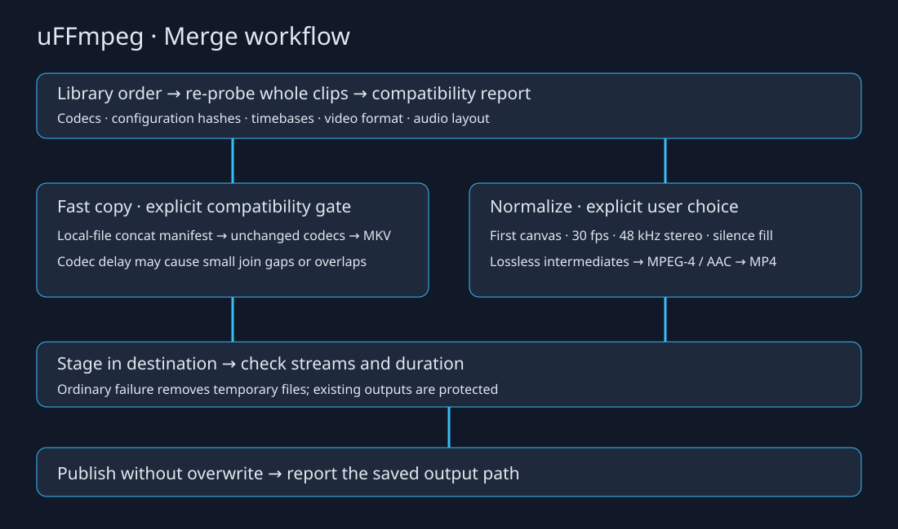

# Phase 4: Merge videos

Status: Implemented; Apple Silicon build, formatting, strict lint and manual merge checks passed. Interactive UI review remains pending.

## Purpose and scope

Reorder clips; compare codec, timebase, dimensions and audio layout; concat demuxer for compatible sources; explicit normalize/re-encode option.

## Work items

- Reorder clips.
- Compare codec, timebase, dimensions and audio layout.
- Concat demuxer for compatible sources.
- Explicit normalize/re-encode option.

## Completion evidence

Produce ordered output, disclose incompatible streams and allow an explicit normalization choice.

## Dependencies

Phase 3 delivers the preceding foundation; later jobs may refine earlier workflows.

## Constraints

Rust and Slint only. No webview, React, JavaScript or Java. No test cases; use builds, diagnostics and manual inspection. No phase duration is committed.

## Diagram

## Delivered

The Merge videos view uses whole clips in current library order; existing reorder/remove controls determine that order. Its compatibility report identifies mismatched stream count/order, codecs, profile/level, extradata SHA-256, timebases, video dimensions, pixel aspect/format, frame rates, field order, color metadata and audio layout. Essential unknown metadata cannot establish copy compatibility. Inputs are re-probed at export time rather than trusting the cached library preview.

Fast copy uses FFmpeg's concat demuxer and MKV output, gated to one moving video plus audio-only accompanying streams. There is no silent fallback to re-encoding. The UI discloses that codec delay and source timestamps can produce small join gaps/overlaps even when metadata matches.

Explicit normalization fits the first clip's display canvas (square pixels, even dimensions), converts video to 30 fps/yuv420p and every audio position to stereo/48 kHz. Missing audio positions receive silence; all-silent merges remain video-only. Duration is quantized up per clip to a frame boundary. First video only; subtitle, additional video and chapter handling is outside this phase. Clips use application-owned FFV1/PCM intermediates followed by concat and final MPEG-4/AAC MP4 encoding, avoiding double lossy encoding. This requires extra disk space and the corresponding native encoders/filters in the bundled FFmpeg build. HDR tone mapping and custom presets are not implemented.

A native save dialog chooses output. Parent directories and mode-specific extensions are validated; existing files, directories and dangling symlinks are refused. The destination-local staged output is probed for video, expected audio count and plausible combined duration before no-overwrite persistence. Normalization directories and manifests are owned by temporary-file guards; ordinary failure removes them. Library edits and normal closing are blocked during a worker operation. Forced-exit recovery/cancellation/progress remain Phase 6 work.

## Recorded manual evidence

- Locked native build, formatting and strict library/binary Clippy checks passed on Apple Silicon.
- Two compatible MPEG-4/AAC sources, each with two audio tracks, merged by copy; Arabic, spaces, an apostrophe and a backslash in a source filename were handled. Output was 3.523 seconds with both tracks.
- Sampling red/blue frames confirmed input order; a second merge with reversed inputs confirmed reversed output order.
- Mixed 160×90/25 fps and 320×180/30 fps video, mono 44.1 kHz/stereo 48 kHz audio, and a silent clip normalized into a 160×90, 30 fps, 4.000-second MP4 with two stereo/48 kHz AAC tracks. Frame sampling confirmed red → green → yellow order.
- Both normalized tracks contained audio before and after the silent clip and zero RMS in its middle. Full normalized output decoding reported no errors or timestamp warnings.
- A source with a half-second delayed video start retained its visual timing relative to audio after normalization; sampled frames remained red at 0.75 seconds and blue at 1.25 seconds.
- All-silent inputs normalized to a 2-second video-only MP4 at the first clip's 320×180 canvas.
- Fast-copy metadata passed for the compatible sources, but decoding its audio through FFmpeg's null muxer reported a small AAC timestamp overlap at the join. This is recorded as a copy-mode limitation, not a gapless-decoding claim; normalization removes that discontinuity in the checked sources.
- Incompatible copy inputs, fewer than two inputs, audio-only entries, wrong output extensions and output collisions were refused. A protected file stayed byte-for-byte unchanged, and rejected outputs were not created.
- A filename with a newline was refused safely by copy mode; normalization handled both a newline-containing input path and output directory. Ordinary exports left no staging or normalization leftovers.
- The native shell remained running for a four-second startup check. Interactive picker/save/reorder/mode behavior and full visual layout remain unverified; the UI inspector could not locate the bare development executable in earlier phases.

No test cases were added or run. Windows/Linux builds and bundled signed installers remain future release work.

## References and diagram

[FFmpeg concat demuxer](https://ffmpeg.org/ffmpeg-formats.html#concat), [FFprobe codec configuration hashes](https://ffmpeg.org/ffprobe.html), [FFmpeg audio/video filters](https://ffmpeg.org/ffmpeg-filters.html).

## Phase 6 integration

The shared FIFO queue now supplies progress, cancellation, retry, graceful shutdown and local job history for this workflow. Earlier worker/closing limitations above describe its original phase delivery; see [Phase 6](06-job-orchestration-and-resilience.md) for current behavior and forced-exit limits.
