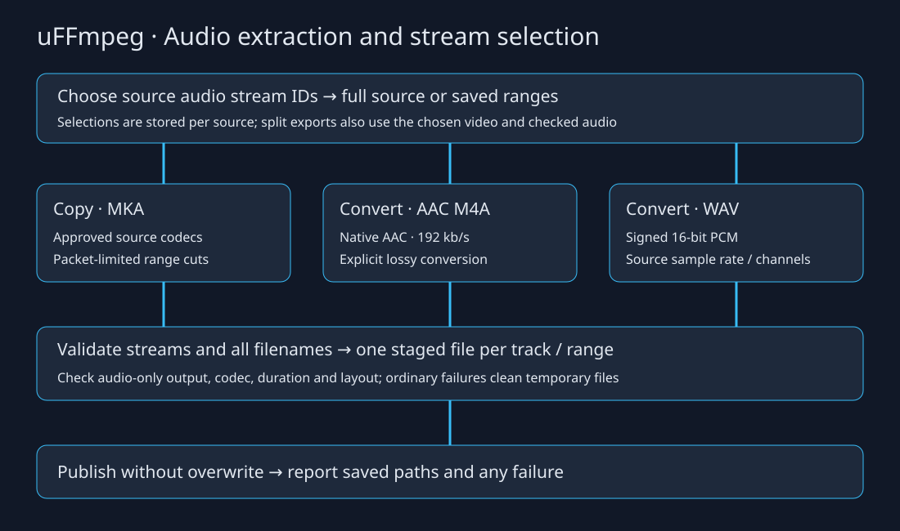

# Phase 5: Audio extraction and stream selection

Status: Implemented; Apple Silicon locked build, formatting, strict lint and manual media checks passed. Interactive UI review remains pending.

## Purpose and scope

Choose video/audio streams; extract full media or selected ranges; compatible audio copy or explicit AAC/WAV conversion; audio-only outputs.

## Work items

- Choose video/audio streams.
- Extract full media or selected ranges.
- Compatible audio copy or explicit aac/wav conversion.
- Audio-only outputs.

## Completion evidence

Extract selected streams and ranges; report media without audio clearly.

## Dependencies

Phase 4 delivers the preceding foundation; later jobs may refine earlier workflows.

## Constraints

Rust and Slint only. No webview, React, JavaScript or Java. No test cases; use builds, diagnostics and manual inspection. No phase duration is committed.

## Diagram

## Delivered

Per-source video/audio selection defaults to the first moving video and all audio tracks. The desktop shows real stream indices, codecs and available language/title tags. Selected video and checked audio are explicitly mapped for split export; zero checked audio means a silent split. Audio extraction uses the same selected audio indices and supports full source or shared saved ranges, including audio-only sources. Merge intentionally keeps its Phase 4 whole-source policy and the UI says so. The import thumbnail remains the first source-video preview, clearly labeled; switching its image is future preview work.

Each chosen track/range becomes a separate file: codec copy in Matroska audio (MKA), native AAC/192 kb/s in M4A, or 16-bit PCM WAV with RF64 auto support. Copy has an explicit conservative codec gate and never silently falls back to re-encoding. The WAV output format avoids ambiguity about multiple audio streams by writing one track per file. Sample rate/channel count is retained for copy/WAV; AAC retains channels but may select a codec-supported sample rate. Conversion can change quality.

The application re-probes and validates stream indices/types, rejects duplicate audio indices, empty selection and missing audio, validates ranges, and preflights all names before starting any work. Staging files are in the destination filesystem. Before no-overwrite publication, output is checked for one audio-only stream, expected codec, positive duration, retained channels and applicable sample rate, plus a range-duration upper bound. Reports retain paths for earlier successes if later processing fails. Ordinary failure cleans staging; forced termination may leave hidden files until Phase 6 recovery is implemented.

Audio copy includes a zero-relative output seek to discard input video-keyframe preroll; its boundary remains packet-limited. Full-source copy retains encoded payloads and may expose codec delay or timestamp rounding in its container duration. Full-source extraction can proceed without an input duration, while ranges require one. Intervals where a selected track has no usable audio fail clearly instead of inventing silence.

## Recorded manual evidence

- Locked native build, formatting and Clippy for workspace libraries/binaries with warnings denied passed on Apple Silicon. No new dependencies were required.
- A Unicode/space/apostrophe source with two video streams and two audio streams exported both AAC tracks separately to MKA. Both outputs had one audio stream and no video, and their encoded-packet SHA-256 hashes matched their corresponding source tracks.
- Explicit AAC and WAV conversion of two 1.2-second ranges produced 1.200000-second outputs with the expected codecs, sample rate/channels and (for WAV) 16-bit depth. All checked outputs decoded without errors.
- Audio identity checks measured approximately 440 Hz for source stream #2 and 880 Hz for #3 in separate WAV outputs, confirming actual track selection.
- An initial copy-range check exposed extra video-keyframe preroll. After correcting seek handling, the 1.2-second request produced a 1.195-second audio-only clip and decoded cleanly; packet rounding is disclosed in the UI.
- Selecting video #1 and audio #3 produced a 320×180 blue video with one audio track; choosing video #0 with no audio produced a 160×90 video-only split. The original default split command still exported successfully.
- Audio-only WAV input extracted successfully. Missing audio, no selection, a video selected as audio, nonexistent and duplicate audio indices, invalid video indices and reversed ranges were refused without published outputs.
- A late collision at track #3/range #2 stopped the entire batch before any output; the protected file stayed byte-for-byte unchanged. A copy-rejected mu-law source converted successfully only after explicit WAV choice.
- Rejected operations left no staging files. The native shell remained running during a four-second startup check; interactive checkbox/range/picker review and full visual layout remain pending.

No test cases were added or run. Windows/Linux and signed self-contained distribution remain unverified.

## References and diagram

[FFmpeg stream mapping](https://ffmpeg.org/ffmpeg.html), [audio containers and RF64](https://ffmpeg.org/ffmpeg-formats.html).

## Automatic batching extension

Whole-source fixed-length splitting is now available alongside saved manual ranges. See [the automatic splitting plan](05a-automatic-splitting.md) for workflow, safeguards and recorded evidence.

## Phase 6 integration

The shared FIFO queue now supplies progress, cancellation, retry, graceful shutdown and local job history for this workflow. Earlier worker/closing limitations above describe its original phase delivery; see [Phase 6](06-job-orchestration-and-resilience.md) for current behavior and forced-exit limits.
