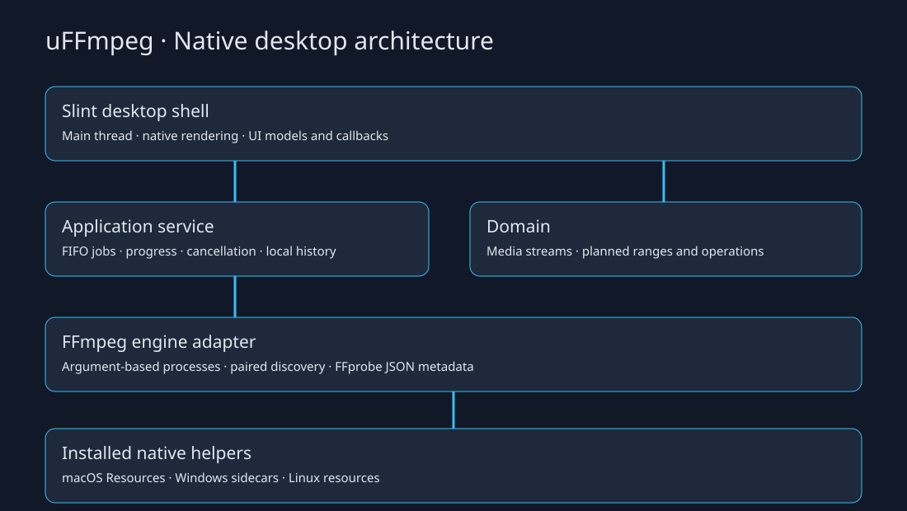
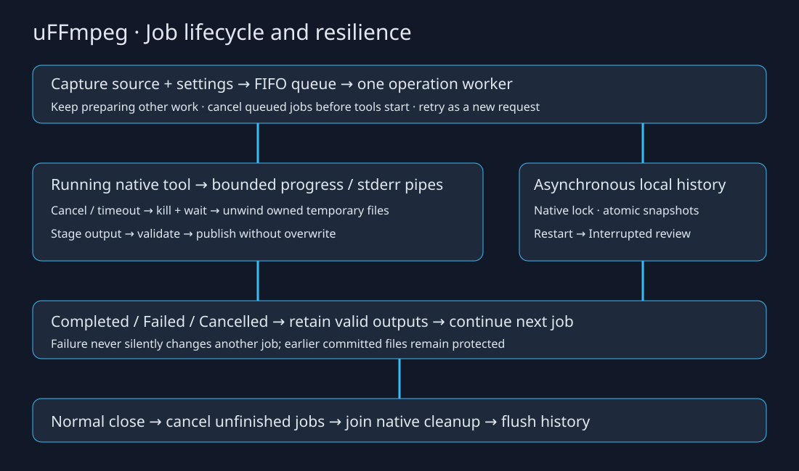

# Phase 6: Job orchestration and resilience

Status: Implemented; Apple Silicon build/lint and manual queue, cancellation, failure, retry, shutdown and recovery checks passed. Interactive native UI review remains pending.

## Purpose and scope

Queue; FFmpeg progress pipe; bounded stderr; cancellation and child cleanup; temporary output staging; collision policy; per-job errors.

## Work items

- Queue.
- Ffmpeg progress pipe.
- Bounded stderr.
- Cancellation and child cleanup.
- Temporary output staging.
- Collision policy.
- Per-job errors.

## Completion evidence

Keep UI responsive, cancel without publishing partial output and recover from individual job failures.

## Dependencies

Phase 5 delivers the preceding foundation; later jobs may refine earlier workflows.

## Constraints

Rust and Slint only. No webview, React, JavaScript or Java. No test cases; use builds, diagnostics and manual inspection. No phase duration is committed.

## Diagram

## Delivered architecture

The application owns one FIFO operation worker and immutable typed requests for import, split, automatic split, audio extraction, merge and diagnostics. UI state is snapshotted at enqueue time; later library/range/stream edits cannot alter queued requests. A worker error or unwind becomes a per-job failure and later requests continue. Queued and active jobs can be cancelled; retry creates a new job ID with the original request. Active/queued rows precede recent history in Jobs.

A shared engine control carries cancellation, coalesced progress and a publication gate into discovery, probing, thumbnails and every export path. Native processes emit `-progress pipe:1`; out_time_us and speed update stage-based progress. Unknown duration remains indeterminate, and 100% is reserved for terminal completion. Stdout/stderr readers continuously drain pipes; stderr retains at most 16 KiB, probe output at most 4 MiB and individual progress lines at most 4 KiB. A child guard kills/reaps on early unwind; cancellation/deadline errors kill and wait before staged resources drop.

Per-output staging, stream/duration validation and no-overwrite persistence remain in the application services. Cancellation is serialized against publication. Earlier complete files remain, but a cancelled job cannot publish another output after cancellation returns. Normal closing cancels unfinished jobs, waits for native cleanup and flushes/joins workers rather than exiting immediately.

History saves immutable requests, states, bounded messages and committed output paths. A dedicated metadata writer serializes/fsyncs/atomically replaces coalesced snapshots off the UI thread and outside publication/state locks. Native file locking prevents concurrent history writers. Queued/running records found at restart become Interrupted without automatic retry, deletion or overwrite. Invalid history stays untouched; the desktop offers session-only fallback with a warning. History location is platform-native or UFFMPEG_STATE_DIR; CLI batches use a sidecar or an explicit history path. Requests normalize paths to absolute locations. The queue caps unfinished jobs at 100, recent history at 200, request JSON at 2 MiB and history at 64 MiB.

## Recorded manual evidence

- Locked build, formatting and strict library/binary Clippy checks passed with the updated lockfile. No test cases were added.
- A four-job queue cancelled a running normalization and a queued audio request, recorded a missing-file split as Failed, then completed the following WAV extraction. Cancelled exports produced no output and left no staging/normalization artifacts.
- Progress advanced through real FFmpeg normalization and encoding phases; automatic selected-stream splits, normalized merge and six per-track audio files completed in FIFO order. Mixed import retained a valid source, skipped a duplicate and recorded the missing-source error separately.
- After restoring a missing source, Retry created a new job ID and completed successfully. Original failed/cancelled records remained in history.
- Cancelling the second segment of a two-part video retained only the first completed clip and removed the unfinished second output. The saved path was recorded in cancelled-job history.
- Shutdown via the same request_shutdown API cancelled active/queued jobs. The known native child process was no longer alive afterward, and no output/intermediate remained; the local check completed about 0.19 seconds after quit (not a latency guarantee).
- A second process attempting the same history was refused by the native lock. A supplied running history record reopened as Interrupted, did not restart and kept its completed output byte-for-byte unchanged. Malformed history was rejected and preserved.
- After moving persistence to its own thread, normal shutdown flushed terminal states and completed paths; relative source input was stored as an absolute path.
- The native desktop stayed running during a four-second startup check with project-local history enabled. Interactive Jobs buttons, close-window behavior and complete visual layout are not claimed as manually verified.

## Limits

Progress is an estimate by processing unit/stage, not a wall-clock ETA. The queue is serial; it does not pause jobs or automatically resume only unfinished files. Retry uses the original destination, so prior completed files may cause a safe collision failure. The import library/project editing session itself is not persisted.

Forced OS termination/power failure can bypass cleanup, leave hidden temporary files or a running native tool, and leave history behind the latest publication. Recovery is a safe review/retry record, not automatic cleanup or a transactional guarantee across output/history files. No arbitrary filesystem objects or stale PIDs are deleted/killed on startup. Windows/Linux runtime behavior and signed self-contained release remain unverified.

References: [FFmpeg progress stream](https://ffmpeg.org/ffmpeg.html), [Rust native file locks](https://doc.rust-lang.org/std/fs/struct.File.html).

